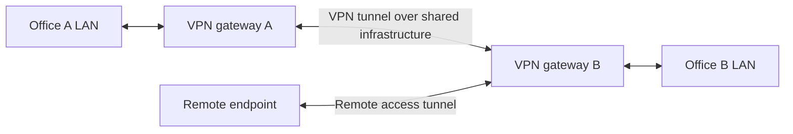
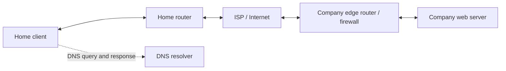
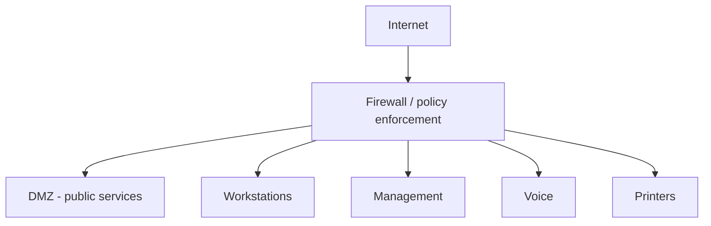
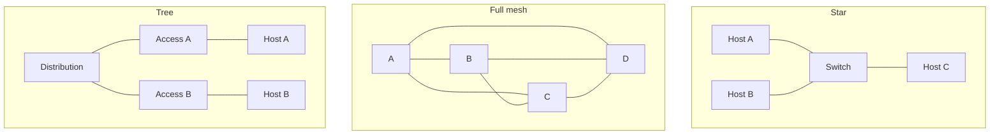
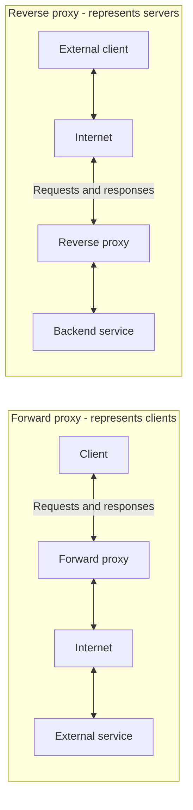
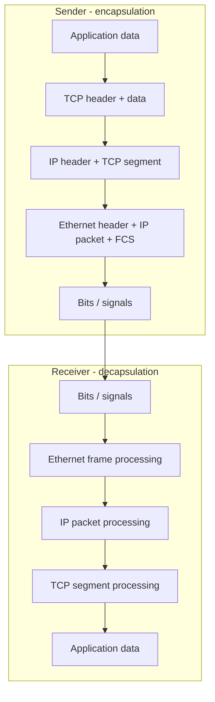
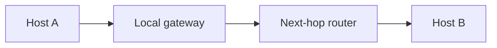

# HTB Academy — Introduction to Networking

  

Personal technical study notes for the Hack The Box Academy **Introduction to Networking** module. This document is a learning reference and a record of my progress, with an emphasis on network fundamentals, troubleshooting, and defensive security.

**Scope:** Sections 1–7 of 21; first documentation milestone. Sections 8–21 are not yet documented. Completion indicates study coverage, not mastery or certification. No hands-on labs have been recorded for these sections.

**Source and attribution:** Based on the HTB Academy module material studied. Explanations are paraphrased; diagrams are original conceptual illustrations, not screenshots of HTB or evidence of personal configurations. Supplementary technical clarifications and hypothetical examples are identified as such.

## Progress

| Section | Topic | Study status |
| --- | --- | --- |
| 01 | Networking Overview | Completed |
| 02 | Network Types | Completed |
| 03 | Networking Topologies | Completed |
| 04 | Proxies | Completed |
| 05 | Networking Models | Completed |
| 06 | The OSI Model | Completed |
| 07 | The TCP/IP Model | Completed — review needed |
| 08–14 | Upcoming sections | Pending |
| 15–21 | Upcoming sections | Pending |

## Contents

- [Section 01 — Networking Overview](#section-01--networking-overview)
- [Section 02 — Network Types](#section-02--network-types)
- [Section 03 — Networking Topologies](#section-03--networking-topologies)
- [Section 04 — Proxies](#section-04--proxies)
- [Section 05 — Networking Models](#section-05--networking-models)
- [Section 06 — The OSI Model](#section-06--the-osi-model)
- [Section 07 — The TCP/IP Model](#section-07--the-tcpip-model)
- [Review and practical learning plan](#review-and-practical-learning-plan)
- [References](#references)

---

## Section 01 — Networking Overview

**Status:** Completed

### Learning Objectives

Understand why networks exist, identify their basic design elements, and recognize the importance of networking for security investigations.

### Key Concepts

A **computer network** consists of interconnected devices that exchange data and share resources through communication protocols. Network design involves three fundamental elements:

| Element | Meaning | Examples |
| --- | --- | --- |
| Topology | Physical or logical organization of connections | Star, mesh, tree |
| Transmission medium | Physical or wireless channel carrying signals | Twisted-pair copper, fiber, coaxial cable, radio |
| Protocol | Rules governing communication | TCP, UDP, IPX (legacy) |

Network failures can be silent. A monitoring system may miss an event if the underlying network path, sensor, or service is unavailable. Understanding how traffic moves is therefore essential to identifying blind spots and troubleshooting security controls.

**Key takeaway:** Networking is a foundation for infrastructure administration, traffic analysis, and incident investigation.

---

## Section 02 — Network Types

**Status:** Completed

### Learning Objectives

Distinguish network types and VPN implementations; understand basic network infrastructure, addressing boundaries, and enterprise segmentation.

### Common and Additional Network Types

| Type | Full name | Typical scope or purpose |
| --- | --- | --- |
| LAN | Local Area Network | Local connectivity in a home, office, or building |
| WLAN | Wireless Local Area Network | Local connectivity using wireless access, commonly Wi-Fi |
| WAN | Wide Area Network | Connects networks over larger geographical areas |
| VPN | Virtual Private Network | Logical connectivity to remote networks or protected resources over existing infrastructure |
| PAN | Personal Area Network | Short-range connectivity between personal devices |
| WPAN | Wireless Personal Area Network | Wireless personal connectivity, such as Bluetooth |
| MAN | Metropolitan Area Network | Connectivity across a city or metropolitan area |
| GAN | Global Area Network | Worldwide interconnection of networks |

A VPN is a connectivity mechanism rather than a geographical network classification. A WAN may be public or private; neither public addressing nor BGP is a requirement for a network to qualify as a WAN. A WLAN is a type of LAN using wireless access. IoT devices may use short-range technologies such as Zigbee or Z-Wave.

### Private IPv4 Addressing

RFC 1918 reserves these IPv4 ranges for private use. They are not globally routable on the public Internet, but can be routed within private infrastructure.

| Prefix | Subnet mask | Address range |
| --- | --- | --- |
| `10.0.0.0/8` | `255.0.0.0` | `10.0.0.0`–`10.255.255.255` |
| `172.16.0.0/12` | `255.240.0.0` | `172.16.0.0`–`172.31.255.255` |
| `192.168.0.0/16` | `255.255.0.0` | `192.168.0.0`–`192.168.255.255` |

### Virtual Private Networks

| Implementation | How it works | Typical use |
| --- | --- | --- |
| Site-to-site | Gateways connect network prefixes at separate sites | Branch offices and private cloud connectivity |
| Remote access | An individual endpoint connects to protected network resources, often through a virtual interface | Remote employees and HTB lab access |
| Clientless SSL/TLS VPN | A browser-based portal exposes selected applications or sessions | Remote access without a traditional network VPN client |

HTB uses OpenVPN for lab connectivity, commonly through a virtual TUN interface. A browser-delivered remote environment such as Pwnbox illustrates browser-based access; it should not automatically be classified as a conventional network-layer VPN.



*Conceptual diagram — site-to-site and remote access connectivity.*

| Feature | Split tunnel | Full tunnel |
| --- | --- | --- |
| Protected network traffic | Through VPN | Through VPN |
| General Internet traffic | Typically direct | Typically through VPN |
| Centralized visibility | Reduced for bypassed traffic | Greater opportunity for inspection |
| Gateway bandwidth demand | Generally lower | Generally higher |

**Security relevance:** Traffic bypassing an enterprise VPN may also bypass network monitoring at that gateway. The decision to use split tunneling depends on risk, performance, endpoint controls, and security policy; it is not universally insecure.

### Basic Network Infrastructure

| Component | Function |
| --- | --- |
| Router | Forwards IP packets between networks |
| Switch | Forwards Ethernet frames within a local Layer 2 network |
| ISP | Provides Internet access/connectivity |
| DNS resolver | Resolves domain names to DNS records, such as IP addresses |
| Web server | Processes web requests and returns responses |
| Client host | Requests or consumes network services |
| Firewall | Enforces traffic policies |



*Conceptual diagram — simplified home-to-company web communication. DNS communication is logical and also traverses the network.*

| Term | Example | Meaning |
| --- | --- | --- |
| FQDN | `www.example.com` | Complete DNS name identifying a host or service name |
| URL | `https://www.example.com/products?id=10` | Identifies a resource, including access scheme and relevant components |
| IP address | `192.168.1.10` | Logical address assigned to a network interface |

**Technical clarification:** A URL may contain an FQDN but is not the same thing. DNS resolves names to records, not to the physical geographical coordinates of a server. For ordinary web access, the client resolves the destination name if necessary, then exchanges traffic with the destination through the network.

### Network Segmentation

A **flat network** has limited internal separation. **Network segmentation** divides infrastructure into smaller networks or security zones so that communication can be controlled according to business requirements.



*Conceptual diagram — possible enterprise security zones. Connections represent policy-controlled paths, not unrestricted access or a deployed configuration.*

| Segment | Security objective |
| --- | --- |
| DMZ | Isolate publicly exposed services from internal resources |
| Workstations | Restrict unnecessary peer-to-peer communication and lateral movement |
| Management | Protect device administration and control-plane communication |
| Voice | Isolate IP telephony; facilitate traffic prioritization where needed |
| Printers | Limit access to vulnerable peripherals and unnecessary outbound connections |

Useful controls include **ACLs** (access control lists), network firewalls, host-based firewalls, and network documentation. **IDS** (intrusion detection systems), such as Suricata and Snort, can alert on suspicious traffic when appropriately configured. IDS alone does not necessarily block traffic.

The module illustrates printer risks and how a compromised peripheral could become a path to sensitive resources. Defensive lessons include restricting printer Internet access, allowing only required printing and scanning flows, limiting unnecessary SMB communication, and monitoring unexpected traffic between zones. OSPF routing updates and other control-plane communication should also be restricted to appropriate trusted peers.

**Technical clarification:** Subnets or VLANs alone do not enforce security between networks. Inter-segment policies, appropriate routing/firewall configuration, and monitoring are required. Rules must reflect actual business dependencies.

### Subnetting and Troubleshooting

The module describes a penetration testing assessment where an incorrect subnet mask led to an incorrect conclusion about a server's availability.

| Prefix | Mask | Total IPv4 addresses | Conventional usable hosts |
| --- | --- | ---: | ---: |
| `/24` | `255.255.255.0` | 256 | 254 |
| `/25` | `255.255.255.128` | 128 | 126 |

| Field | Server subnet | Client subnet |
| --- | --- | --- |
| Network | `10.20.0.0/25` | `10.20.0.128/25` |
| Host range | `.1`–`.126` | `.129`–`.254` |
| Gateway | `10.20.0.1` | `10.20.0.129` |
| Example host | `10.20.0.10` (domain controller) | `10.20.0.200` (workstation) |
| Broadcast | `10.20.0.127` | `10.20.0.255` |

In the course scenario, the assessment endpoint was configured as `10.20.0.252/24` with gateway `10.20.0.1`, instead of respecting the actual client `/25` network. It could incorrectly treat server-subnet destinations as on-link and attempt local address resolution instead of routing through the proper gateway. Actual connectivity depends on the network configuration and policies.

**Key takeaway:** Verify IP addresses, prefix lengths, routing tables, gateway configuration, and traffic policies before declaring a destination offline. Segmentation can improve both security and diagnostic clarity.

---

## Section 03 — Networking Topologies

**Status:** Completed — review recommended

### Learning Objectives

Differentiate physical and logical topologies, identify common networking components, and understand how topology affects availability and troubleshooting.

### Physical vs. Logical Topology

- **Physical topology:** actual links, devices, and cabling arrangements.
- **Logical topology:** how data flows and how access or forwarding is organized, regardless of the physical arrangement.

Computers arranged in a circle but physically connected to a central switch do not automatically form a ring network.

| Wired media | Wireless media |
| --- | --- |
| Coaxial cable | Wi-Fi |
| Fiber-optic cable | Cellular |
| Twisted-pair cable | Satellite |

### Network Nodes and Components

A node is a connection point or device in a network; a NIC (Network Interface Controller) is an interface through which a device communicates.

| Component | Function |
| --- | --- |
| NIC | Provides a network interface |
| Repeater | Regenerates or repeats signals |
| Hub | Repeats incoming signals to other ports |
| Bridge | Connects Layer 2 segments and filters frames |
| Switch | Forwards frames based on link-layer addressing |
| Router | Routes IP packets between networks |
| Modem | Adapts signals for the access medium |
| Gateway | Provides access between networks or systems |
| Firewall | Enforces traffic security policies |

### Eight Fundamental Topologies

| Topology | Structure | Advantage | Limitation |
| --- | --- | --- | --- |
| Point-to-point | Dedicated link between two nodes | Simple direct connectivity | Limited to two directly linked endpoints |
| Bus | Shared transmission backbone | Relatively little cabling | Shared medium and backbone failure risk |
| Star | Individual links to a central device | Easy to manage; individual link failures are localized | Central component can be a single point of failure |
| Ring | Nodes form a closed loop | Organized paths | An unprotected ring can be disrupted by a failure |
| Mesh | Multiple interconnections | Alternate paths and redundancy | Higher cost and management complexity |
| Tree | Hierarchical branching structure | Scalable organization | Upper-level failures can affect branches |
| Hybrid | Combines distinct topology types | Flexible design | More complex implementation |
| Daisy chain | Sequential links from node to node | Simple chaining | Intermediate failures may partition the network |



*Conceptual diagram — star, full mesh, and hierarchical tree structures.*

```text
Point-to-point: A --- B

Bus:       A     B     C
           |     |     |
        ---+-----+-----+--- shared medium

Ring:      A --- B
           |     |
           D --- C

Daisy chain: A --- B --- C --- D
```

*Conceptual illustrations — a shared bus, a closed ring, and an open chain have different forwarding and failure characteristics.*

### Important Distinctions

**Point-to-point vs. peer-to-peer:** A point-to-point topology describes a link between two nodes. Peer-to-peer describes a distributed architecture where endpoints can share resources or roles; it is not a specific physical topology.

**Full vs. partial mesh:** In a full mesh, every node connects directly to every other node. In a partial mesh, only selected nodes have multiple links. Partial mesh provides redundancy where it is most valuable without requiring all possible links.

**Ring vs. daisy chain:** A ring closes the loop; a daisy chain has endpoints. Traditional Token Ring uses token passing, but not all ring networks use that method. Daisy chaining is also encountered in industrial automation. Physical layouts and logical access methods are not always the same.

**Star vs. tree:** A tree extends the central connection idea into a hierarchy. Modern enterprise networks often add redundant paths to such hierarchical designs. Spanning Tree is an example of a logical loop-free topology mechanism.

### Technical Supplement — Resilience and Failure Analysis

| Term | Meaning |
| --- | --- |
| Single Point of Failure (SPOF) | A component whose failure can interrupt an affected service or system |
| Redundancy | Additional resources or paths that can provide alternatives |
| Fault tolerance | Ability to continue functioning despite certain failures |
| Scalability | Ability to accommodate growth without unacceptable degradation |
| High availability | Design intended to minimize downtime |

A central switch failure can interrupt communication in a simple star. A mesh may retain alternative paths after a link fails, provided routing or switching protocols can use them. A chain may become partitioned when an intermediate forwarding node fails.

**Security relevance:** Topology maps help NOC and SOC analysts identify affected services, traffic paths, monitoring points, infrastructure dependencies, and potential routes for lateral movement.

### My Learning Notes

I initially found network topologies confusing. Comparing physical connections, logical data flow, and component failure scenarios gives me a more useful way to distinguish them. I need further review of physical vs. logical topology, partial vs. full mesh, and redundant paths.

**Key takeaway:** Understand what happens when a link or device fails, rather than only memorizing topology names.

---

## Section 04 — Proxies

**Status:** Completed

### Learning Objectives

Understand intermediary services, distinguish forward and reverse proxies, and recognize transparent vs. explicit deployment and security use cases.

### What Is a Proxy?

A **proxy** acts as an intermediary on behalf of clients or servers. It may create separate connections and perform filtering, logging, access control, caching, or application-aware processing, depending on the implementation.

| Proxy | Conventional IP gateway |
| --- | --- |
| Acts on behalf of a communication party | Provides a path between networks |
| May establish separate connections | Normally forwards packets toward their destination |
| HTTP proxies operate at the application layer | IP routing operates at the network layer |
| Can process protocol-level messages | Does not normally interpret application content |

**Technical clarification:** Proxy and gateway are not mutually exclusive terms; application gateways can perform proxy functions. Proxies are not defined solely by their ability to inspect all traffic contents. Some relay encrypted data without decrypting it; SOCKS proxies can relay transport connections without interpreting the application protocol. A VPN is not automatically a proxy.

### Forward vs. Reverse Proxy



*Conceptual diagram — both types carry requests and responses; their roles differ.*

| Feature | Forward proxy | Reverse proxy |
| --- | --- | --- |
| Represents | Clients | Backend servers/services |
| Typical focus | Outbound client access | Inbound access to hosted services |
| Main security goal | Enforce client access policies and improve visibility | Reduce direct backend exposure and control incoming requests |
| Processes requests and responses | Yes | Yes |
| Example | Corporate web proxy | Cloudflare reverse proxy |

A **forward proxy** receives a client's request, applies configured policies, communicates with the permitted destination, and returns its response. Organizations can require managed endpoints to use approved proxies and restrict direct Internet access.

A **reverse proxy** receives requests addressed to a service, forwards them to an appropriate backend, and relays responses. Depending on configuration, it may support load balancing, TLS termination, caching, WAF inspection, or DDoS mitigation.

### Transparent vs. Non-Transparent Proxy

| Feature | Transparent / intercepting | Non-transparent / explicit |
| --- | --- | --- |
| Explicit client proxy setting | Generally not required | Required, manually or automatically |
| Traffic direction to proxy | Network redirection/interception | Client or application configuration |
| Awareness | Client may not know the proxy is present | Client software is configured to use the proxy |

Transparency describes deployment behavior, not whether the proxy represents a client or a server. A transparent proxy does not automatically decrypt HTTPS. TLS termination or authorized TLS inspection is necessary to access encrypted application content in typical HTTPS deployments.

### Important Tools and Technologies

| Tool / technology | Purpose |
| --- | --- |
| Burp Suite | HTTP proxy for web application security testing |
| Cloudflare | Reverse proxy and optional application protection services |
| ModSecurity | Web application firewall engine |
| OWASP Core Rule Set | Rules for detecting common web application attacks |
| SOCKS | Proxy protocol for relaying connections |
| Sysmon | Windows activity telemetry, including DNS query events when configured |
| IDS | Detects suspicious activity within its monitoring coverage |

**Cybersecurity relevance:** Proxy logs support investigations and traffic-policy enforcement. DNS telemetry and other monitoring sources complement proxy visibility. A proxy cannot guarantee detection of malware, and browser behavior or malware proxy awareness should not be treated as universal assumptions.

### My Learning Notes

I initially associated forward proxies with outgoing traffic and reverse proxies with incoming traffic. Both can handle requests and responses. The most important distinction is which party the proxy represents: clients or backend servers.

**Key takeaway:** A proxy is an intermediary, not simply a mechanism that changes an IP address. Its security capabilities depend on implementation and policy.

---

## Section 05 — Networking Models

**Status:** Completed

### Learning Objectives

Compare OSI and TCP/IP, understand Protocol Data Units (PDUs), and explain encapsulation and decapsulation.

### OSI vs. TCP/IP

Layered models separate communication into functions so that protocols and implementations can interoperate and be analyzed more easily. OSI is a seven-layer reference model; TCP/IP is a four-layer representation of the Internet protocol suite used in practice.

| OSI layer | TCP/IP layer | Common PDU | Example |
| --- | --- | --- | --- |
| 7 — Application | 4 — Application | Data | HTTP, DNS |
| 6 — Presentation | 4 — Application | Data | Encoding and data representation |
| 5 — Session | 4 — Application | Data | Session coordination |
| 4 — Transport | 3 — Transport | TCP segment / UDP datagram | TCP, UDP |
| 3 — Network | 2 — Internet | Packet | IP, ICMP |
| 2 — Data Link | 1 — Link | Frame | Ethernet |
| 1 — Physical | 1 — Link | Bits | Electrical, optical, or radio signals |

*Conceptual mapping — protocol placement is approximate in real implementations. The term IP datagram is also valid at the network layer.*

### Protocol Data Units (PDUs)

A **PDU** is a unit of information exchanged between peer protocol entities. Its format depends on the protocol and layer. Introductory models commonly describe upper-layer information as data, transport units as segments or datagrams, network units as packets, link-layer units as frames, and physical transmission as bits.

- **Header:** protocol control information placed before the payload.
- **Payload:** information carried by a protocol; it can include an entire higher-layer PDU.
- **Trailer:** control information placed after a payload, such as Ethernet FCS.

### Encapsulation and Decapsulation

Encapsulation adds protocol-specific information as data passes down the networking stack. The receiving system interprets that information and delivers the encapsulated payload upward.



*Conceptual diagram — simplified TCP/IP over a single Ethernet link. FCS means Frame Check Sequence, used for error detection.*

| Stage | Information added or represented |
| --- | --- |
| Application | Protocol-specific application messages |
| Transport | TCP or UDP header, including ports |
| Internet / Network | IP header, including source and destination IP addresses |
| Link / Data Link | Local-link header and, for Ethernet, FCS trailer |
| Physical | Information transmitted as physical signals |

**Technical clarification:** Not every OSI layer adds a separate header in every implementation. In a routed path, routers typically remove the incoming link-layer framing and create new framing for the next link; the IP packet is forwarded with relevant fields updated (such as TTL or Hop Limit). This differs from full application decapsulation at an endpoint.

### My Learning Notes

I initially found PDUs confusing. I learned that a PDU is the data unit of a specific protocol layer and that its format and terminology change during encapsulation. I need to reinforce the relationship between headers, payloads, segments, packets, frames, and bits.

**Key takeaway:** Understanding protocol layering and encapsulation is fundamental to interpreting packet captures and diagnosing communication problems.

---

## Section 06 — The OSI Model

**Status:** Completed

### Learning Objectives

Identify the seven OSI layers and understand their functions, service relationships, and use in troubleshooting.

### Seven Layers of OSI

**OSI** stands for Open Systems Interconnection. The reference model was standardized by the International Organization for Standardization (ISO) and the International Telecommunication Union (ITU). Each layer provides services to the layer above and relies on services below it.

| Layer | Main responsibility | Representative examples |
| --- | --- | --- |
| 7 — Application | Network services used by applications | HTTP, FTP, DNS |
| 6 — Presentation | Data representation, encoding, compression, transformation | Character encodings, image formats, encryption functions |
| 5 — Session | Establishing, managing, and coordinating logical sessions | Session coordination, synchronization |
| 4 — Transport | End-to-end data delivery and protocol-dependent reliability | TCP, UDP, ports |
| 3 — Network | Logical addressing and packet forwarding across networks | IP, ICMP, routers |
| 2 — Data Link | Local frame delivery, media access, error detection | Ethernet, MAC addresses, switches |
| 1 — Physical | Transmission through electrical, optical, or radio signals | Copper, fiber, radio interfaces |

The course groups layers 5–7 as application-oriented and layers 2–4 as transport-oriented, with Layer 1 responsible for physical transmission. Another conceptual grouping shown in the module is host layers (4–7) and media layers (1–3).

A sender processes data from upper to lower layers (7 → 1); the destination processes received data from lower to upper layers (1 → 7). Both endpoints can act as sender and receiver. See [Section 05](#section-05--networking-models) for the encapsulation diagram. Real stacks need not implement each conceptual layer separately.

### Technical Supplement — Layer-Based Troubleshooting

| Layer | Example issue | Diagnostic focus |
| --- | --- | --- |
| 1 | Disconnected cable or weak radio signal | Link status, cabling, signal quality |
| 2 | Incorrect VLAN or local forwarding | Switching, VLAN, MAC information |
| 3 | Wrong IP prefix or missing route | Addressing, routing, gateway |
| 4 | Failed TCP connection | Listening ports, transport state, firewall policies |
| 5 | Unexpected session termination | Session state and establishment |
| 6 | Encoding or encryption incompatibility | Data formats and TLS-related issues |
| 7 | Failed DNS lookup or HTTP error | Application service and protocol responses |

These examples are diagnostic starting points, not rigid boundaries; a symptom at one layer may originate elsewhere.

| Diagnostic purpose | Windows examples | Linux examples |
| --- | --- | --- |
| Interface/IP configuration | `ipconfig /all` | `ip addr` |
| Neighbor information | `arp -a` | `ip neigh` |
| IP reachability | `ping` | `ping` |
| Network path | `tracert` | `traceroute` |
| Connections and listening sockets | `netstat -ano` | `ss -tuln` |
| DNS resolution | `nslookup` | `dig` |
| HTTP communication | `curl.exe` | `curl` |

*Supplementary reference commands only. No execution or results have been documented for this module. Some tools may need to be installed. ICMP filtering can cause ping to fail even when a service is reachable.*

### My Learning Notes

I learned that OSI is a conceptual reference model, not a communication protocol. When sending data, a system processes information from Layer 7 toward Layer 1; a receiving system processes information in the opposite direction. Both devices can act as senders and receivers.

**Key takeaway:** Use the model to organize troubleshooting and analyze communication rather than treating it as an exact implementation of every network stack.

---

## Section 07 — The TCP/IP Model

**Status:** Completed — protocol tasks and layer functions require further review

### Learning Objectives

Understand the Internet protocol suite, identify its four layers, and relate addressing, routing, transport, ports, and name resolution to their respective protocols.

### Four-Layer Model

TCP/IP stands for Transmission Control Protocol / Internet Protocol. The term also refers to the broader **Internet Protocol Suite**, not only TCP and IP. TCP corresponds to OSI Layer 4 and IP to OSI Layer 3. For the complete layer mapping, see [Section 05](#section-05--networking-models).

| TCP/IP layer | Main responsibility | Examples |
| --- | --- | --- |
| 4 — Application | Protocols used for application communication | HTTP, DNS, SSH, FTP |
| 3 — Transport | End-to-end data transport and application multiplexing | TCP, UDP |
| 2 — Internet | Logical addressing, packet forwarding, and routing | IPv4, IPv6, ICMP |
| 1 — Link | Communication across local links and physical media | Ethernet, Wi-Fi |

### Important TCP/IP Tasks

| Task | Protocol | Explanation |
| --- | --- | --- |
| Logical addressing | IP | Identifies interfaces and organizes addresses into network prefixes |
| Routing | IP | Packets are forwarded toward their destinations using routes and next-hop decisions |
| Error and flow control | TCP | Detects loss and supports reliable ordered transport and receiver-side flow control |
| Application support | TCP / UDP | Port numbers distinguish transport endpoints and allow multiple communications |
| Name resolution | DNS | Resolves domain names to IP addresses and other DNS records |
| Diagnostics | ICMP | Provides error reporting and diagnostic messages |

**Technical clarification:** IP provides best-effort delivery; it does not guarantee arrival, ordering, or duplicate-free delivery. TCP adds reliability mechanisms including acknowledgments, sequence numbers, and retransmission. Flow control protects the receiving endpoint from being overwhelmed; congestion control adapts sending behavior to network conditions. TCP reliability does not imply that a connection can never fail.

### Technical Supplement — TCP vs. UDP

| Feature | TCP | UDP |
| --- | --- | --- |
| Communication | Connection-oriented | Connectionless |
| Data model | Ordered byte stream | Discrete datagrams |
| Built-in reliability | Yes | No delivery or ordering guarantee |
| Retransmission / acknowledgment | Provided | Not provided by UDP itself |
| Flow control | Provided | Not provided by UDP itself |
| Minimum header | 20 bytes | 8 bytes |
| Typical applications | SSH, HTTPS over TCP | Voice, games, many DNS queries |

UDP has lower transport header overhead; it is not guaranteed to be faster. Applications may provide their own reliability above UDP.

### Addressing and Routing

- **IP address:** logical interface identifier.
- **Subnetting:** division of address space into network prefixes.
- **CIDR:** classless representation of network prefixes, such as `/24`.
- **Network classes:** historical class-based IPv4 addressing.
- **Routing table:** information used to choose a forwarding path.
- **Default gateway:** next hop for destinations without a more specific applicable route, when configured.



*Conceptual diagram — routers forward packets according to destination IP prefixes and their routing information. The actual return path may differ.*

### Technical Supplement — Common Service Ports

| Service | Conventional port | Transport |
| --- | ---: | --- |
| FTP control | 21 | TCP |
| SSH | 22 | TCP |
| SMTP | 25 | TCP |
| DNS | 53 | UDP / TCP |
| DHCPv4 | 67 / 68 | UDP |
| HTTP | 80 | TCP |
| HTTPS | 443 | TCP; UDP for HTTP/3 over QUIC |
| SMB | 445 | TCP |
| RDP | 3389 | TCP / UDP |

Port numbers are conventional defaults, not proof that a particular application is running on a given port.

### Hypothetical Example — Accessing an HTTPS Website

1. The client obtains the destination IP address through DNS if the answer is not already available.
2. For HTTPS over TCP, the client establishes a TCP connection to the service, commonly port 443.
3. TLS establishes a protected channel for HTTP requests and responses.
4. IP forwarding and link-layer delivery carry traffic throughout all of these exchanges, including DNS and the connection handshake; they are not separate operations that happen only at the end.

This is an explanatory example, not a completed lab. HTTP/3 uses QUIC over UDP instead of the illustrated TCP transport.

### My Learning Notes

I understood the general structure of the TCP/IP model and the responsibilities of its four layers. I need further review to confidently explain the protocol tasks, particularly logical addressing, routing, error and flow control, application support, and name resolution. Practical exercises and active recall will help reinforce these concepts.

**Key takeaway:** TCP/IP describes how real IP networks support communication. Understanding what each protocol contributes is more important than memorizing the wording of each task.

---

## Review and Practical Learning Plan

The next step is to continue studying the remaining HTB sections and then review these notes through active recall. Cisco Packet Tracer practice will be documented separately from this module, with actual configurations and results when available.

| Review topic | Intended outcome |
| --- | --- |
| Network types and segmentation | Explain LAN, WAN, VPN, security zones, and why access policies matter |
| Topologies and resilience | Identify physical vs. logical layouts and predict simple failure scenarios |
| Routing and addressing | Explain local vs. remote destinations, subnet masks, and default gateways |
| Proxies | Explain which party each proxy represents and how traffic inspection differs |
| OSI and TCP/IP | Map layers and identify their responsibilities |
| Encapsulation | Identify headers, payload, segment/datagram, packet, frame, and bits |
| Transport and applications | Explain TCP vs. UDP, ports, DNS, and how protocols cooperate |

### Suggested Practical Follow-up (not yet performed)

- Build a simple switched LAN and test connectivity.
- Create two IP networks and verify routing through a gateway.
- Compare expected and unexpected connectivity after changing a subnet mask.
- Explore segmentation and controlled inter-network access when ready.
- Later, use Wireshark or another packet analyzer to identify Ethernet, IP, TCP/UDP, and DNS fields in authorized traffic.

For future hands-on documentation, record the objective, procedure or commands, observed outcome, and what was learned. Do not label a theoretical example as lab evidence.

### Self-check Questions

1. What is the difference between a router and a switch?
2. Why can a flat network increase exposure to lateral movement?
3. What happens when a central switch in a simple star topology fails?
4. Which party does a forward proxy represent? What about a reverse proxy?
5. What is a PDU, and how does it change across network layers?
6. How do the four TCP/IP layers map to OSI?
7. What does IP provide, and what does it not guarantee?
8. How do TCP, UDP, DNS, and port numbers contribute to communication?
9. Why can an incorrect subnet mask cause a host to appear unreachable?

## References

- [Hack The Box Academy — Introduction to Networking](https://academy.hackthebox.com/module/details/34) — primary study source, Sections 1–7.
- [RFC 1918 — Address Allocation for Private Internets](https://www.rfc-editor.org/rfc/rfc1918) — supplementary private IPv4 addressing reference.
- [RFC 1122 — Requirements for Internet Hosts: Communication Layers](https://www.rfc-editor.org/rfc/rfc1122) — supplementary Internet protocol layering reference.
- [RFC 9293 — Transmission Control Protocol](https://www.rfc-editor.org/rfc/rfc9293) and [RFC 768 — User Datagram Protocol](https://www.rfc-editor.org/rfc/rfc768) — supplementary transport protocol references.
- [OWASP Core Rule Set](https://owasp.org/www-project-modsecurity-core-rule-set/) — web application firewall reference identified in the module.

---

*First milestone: Sections 1–7. This document will be expanded as study progresses; practical experience will be recorded only when performed.*
